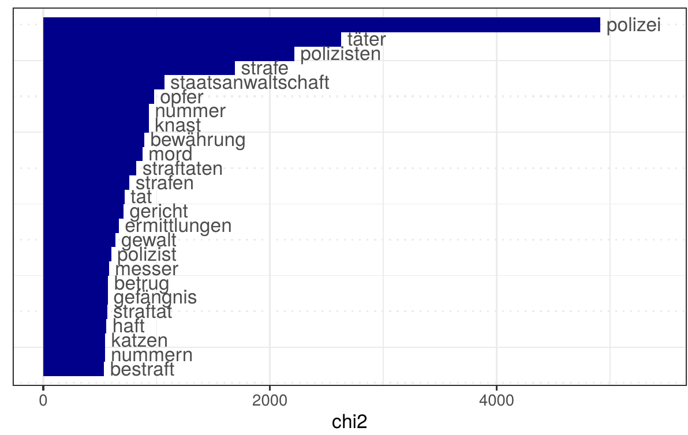
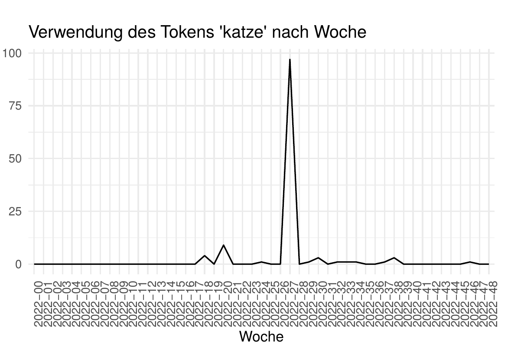
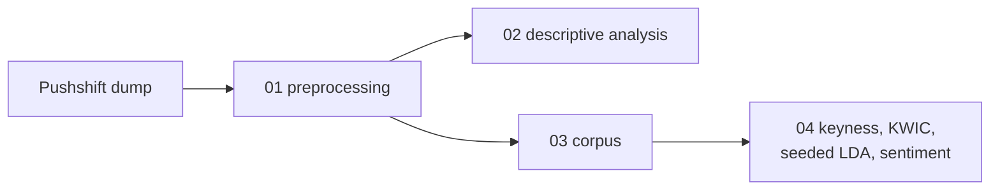

# MediaKrim: Crime Talk on Reddit

How do German-speaking Reddit users talk about crime? A text-mining study of the crime category of
[r/de](https://www.reddit.com/r/de/), built with R and [quanteda](https://quanteda.io/).


Social media is a field site you can study from the couch. This project shows how far a
student laptop gets with free tools: descriptive statistics, keywords, topic models and
sentiment, always checked against the posts behind the numbers. quanteda was chosen because
its data structures handle large corpora on modest hardware.

## What the 2022 data show

| | Crime | Society (reference) |
|---|---:|---:|
| Posts | 1,028 | 2,411 |
| Comments | 59,314 | 179,141 |

- **Attention is uneven.** Almost 10 % of crime posts get no comment at all, while the three
  busiest threads, led by the climate protests of *Letzte Generation*, draw almost 5 % of all comments.
- **Threads peak fast.** In one of the busiest threads, most comments arrived about two hours
  after posting, once Reddit's algorithm showed it to a wider audience.
- **The police is the defining term.** It tops the keywords. Words around it, such as *Bodycam*,
  *Taser*, *Fehlverhalten* and *Oury Jalloh*, point to a critical debate about policing.
- **Virality distorts counts.** "Katzen" (cats) ranks among the top 25 keywords, but only because
  of one thread about a curfew for cats. Keyword lists need a qualitative check.

<p align="center">
  
  
</p>
<p align="center"><sub><b>Left:</b> keywords of the crime category against the society category.
<b>Right:</b> "Katze" per week in 2022, one spike in week 26.</sub></p>

## How it works



Posts and comments come from the [Pushshift](https://arxiv.org/abs/2001.08435) archive, collected
before Reddit closed its API in 2023. The scripts cover January 2018 to November 2022; the
results above use 2022. Posts flaired *Kriminalität* form the corpus, posts flaired *Gesellschaft*
the reference. The data are not included: they contain user content and account names, and
results are only reported in aggregate.

## Run it

Put the extracted CSVs in `data_raw/`, open `MediaKrim.Rproj` and run the scripts `01` to `04`.

```r
install.packages(c("tidyverse", "quanteda", "quanteda.textstats", "quanteda.textplots",
                   "seededlda", "ggrepel", "GGally", "sandwich", "lmtest", "remotes"))
remotes::install_github("quanteda/quanteda.sentiment")
remotes::install_github("trinker/lemmar")
```

## Known issues

- The code was corrected in October 2026 (sentiment now keeps negations, the regression is
  clustered by thread, topics are attached to all posts). Numbers can differ slightly from the
  original write-up.
- The sentiment dictionaries were built for political language, not social media, and miss irony.
  Treat sentiment results as a first impression.

## License

Code under [MIT](LICENSE). Reddit content is not part of this repository.
